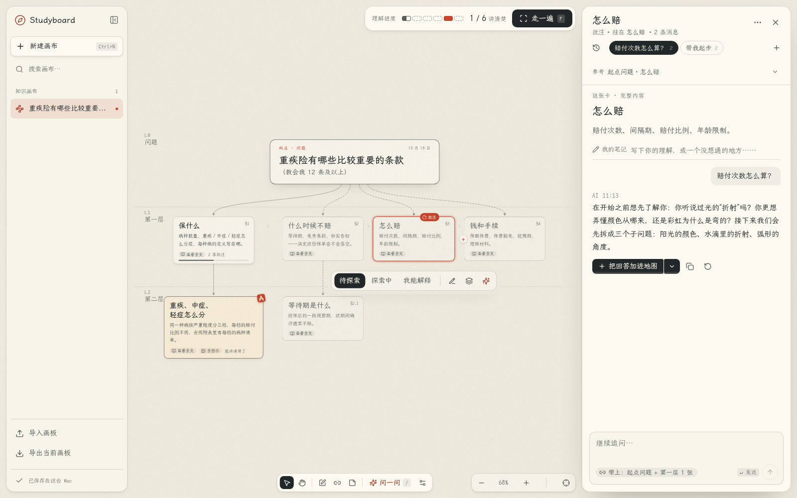

# Studyboard — macOS AI 视觉学习白板

把一个问题展开成知识地图，在概念旁提问，逐步记录自己的理解。

Studyboard 是面向 macOS 的本地优先 AI 学习白板（visual learning canvas）。它把概念卡片、关系连线和 AI 对话放在同一张无限画布上，适合拆解复杂概念、梳理知识关系和复习学习过程。界面以中文为主，目前处于早期预览阶段。

**[下载 macOS 版](https://github.com/Yaphet2015/studyboard/releases/tag/latest)** · [使用指南](docs/user-guide.md) · [本地开发](#本地开发) · [反馈问题](https://github.com/Yaphet2015/studyboard/issues)

> Studyboard is a local-first AI learning canvas for macOS. Build concept maps, ask questions with selected context, and export your learning as JSON, Markdown, or PNG. The interface is primarily Chinese. Bring your own API key for AI features.

<picture>
	<source media="(prefers-color-scheme: dark)" srcset="docs/images/hero-dark.png">
	
</picture>

## 你可以用它做什么

| 学习动作        | Studyboard 提供的功能                                        |
| --------------- | ------------------------------------------------------------ |
| 拆解一个问题    | 保留起始问题，逐层展开概念卡片，在无限画布上平移、缩放和整理 |
| 理清概念关系    | 拖动卡片、连接概念、编辑关系标签，查看层级大纲               |
| 带着上下文问 AI | 选择一张或多张卡片提问，发送前查看引用范围，每段对话独立保存 |
| 整理回答        | AI 回答保留在批注中，选取需要的内容后再加入知识地图          |
| 检查自己的理解  | 标记「待探索 / 探索中 / 我能解释」，记录预测与解释           |
| 保存与分享      | 本地自动保存，支持撤销；导出学习数据、Markdown 和整图 PNG    |

内置浏览器渲染演练可以离线使用：调整 CSS 宽度和背景色，观察布局、换行与绘制的区别。其他主题的 AI 探索需要自己的模型 API 密钥。

## 下载与安装

当前提供 **macOS Apple Silicon（M 系列芯片）** 预览版：

- [下载 DMG](https://github.com/Yaphet2015/studyboard/releases/latest/download/Studyboard-arm64.dmg)：打开后将 Studyboard 拖入「应用程序」。
- [下载 ZIP](https://github.com/Yaphet2015/studyboard/releases/latest/download/Studyboard-arm64.zip)：解压后将应用移入「应用程序」。
- [查看发布记录与构建信息](https://github.com/Yaphet2015/studyboard/releases/tag/latest)。

预览版使用 ad-hoc 签名，尚未配置 Developer ID 签名或 Apple 公证。首次打开若被 macOS 拦截，可在 Finder 中右键点击 Studyboard →「打开」；若仍被拦截，可在「系统设置 → 隐私与安全性」中查看「仍要打开」。只对你信任的本仓库构建执行此操作。

每次 `main` 分支构建且全部检查通过后，GitHub Actions 会更新滚动发布 `latest`。PR 预览产物在对应 [Actions 运行记录](https://github.com/Yaphet2015/studyboard/actions/workflows/macos.yml) 的 Artifacts 中。

## 第一次使用

1. **先试内置演练**：不填密钥也可以操作画布，体验视觉学习流程。
2. **连接 AI**：按 `⌘.` 打开「设置 → AI 服务」，填写 API 地址、模型 ID 和密钥。默认地址为 `https://api.openai.com/v1`，默认模型为 `gpt-4o-mini`；也支持兼容 OpenAI Chat Completions 的 HTTPS 服务。
3. **从问题开始**：新建白板，输入想弄懂的问题，例如「浏览器为什么会重新布局？」。让 AI 带你开始，再逐层展开。
4. **沿着概念追问**：选中卡片后按 `/` 提问，也可以多选卡片，把它们一起作为上下文。查看引用，再发送问题。
5. **留下学习记录**：整理卡片和关系，标记理解进度，按需导出。

保存设置不会调用模型。「测试连接」、主动提问和已配置 AI 后的卡片悬停或选中提示会请求服务商，可能产生 API 费用。卡片提示会缓存，相关状态未变时复用结果。测试连接不会保存当前表单配置。

## 数据与隐私

- **白板与对话保存在本机**：macOS 通常位于 `~/Library/Application Support/Studyboard/`，不提供云同步。正常关闭前会保存；强制结束进程仍可能丢失未提交的编辑。
- **密钥加密保存**：桌面主进程通过 Electron `safeStorage` 加密 API 密钥，界面只显示末四位。系统加密不可用时，只在内存中保留到退出。
- **AI 请求发送相关内容**：服务商会收到当前问题、该段对话历史、原始主题、选定概念或附近分支，以及整张白板的精简提纲。发送前可查看引用；其他白板和其他批注的对话不会自动加入。
- **导出可携带完整对话**：`.studyboard.json` 可导入后继续学习，不包含 API 密钥或服务商配置。Markdown 和 PNG 用于阅读与展示。

白板和对话文件不提供本地静态加密。数据目录、恢复行为与导出边界见[使用指南](docs/user-guide.md)。

## 常用快捷键

| 快捷键        | 操作                |
| ------------- | ------------------- |
| `⌘N`          | 新建白板            |
| `/`           | 带着所选卡片问 AI   |
| `N`           | 放置自由批注        |
| `0`           | 查看全图            |
| `F`           | 走一遍              |
| `空格` + 拖动 | 临时平移画布        |
| `⌘Z` / `⌘S`   | 撤销编辑 / 立即保存 |
| `⌘Enter`      | 发送批注问题        |
| `⌘.`          | 打开设置            |
| `⌘K`          | 打开命令面板        |

多选、连线、对话管理和其他快捷键见[完整操作说明](docs/user-guide.md#快捷键)。

## 本地开发

需要 Node.js **22.19.0 或更新版本**，CI 使用 Node **24.19.0**。pnpm 版本由 [`package.json`](package.json) 的 `packageManager` 字段锁定，可通过 `corepack enable` 启用。

```sh
git clone https://github.com/Yaphet2015/studyboard.git
cd studyboard
pnpm install
pnpm dev
```

技术栈：Electron 44.8.0、React 19、TypeScript、React Flow、Vite；真实 AI 运行时使用 `pi-durable`，对话存储使用 SQLite。Electron 内嵌 Node 24.22.0，支持 `node:sqlite`。

`pnpm dev:web` 只启动浏览器界面预览：白板存入浏览器本地存储，不接收 API 密钥，也不调用 AI。

| 命令             | 用途                         |
| ---------------- | ---------------------------- |
| `pnpm typecheck` | 检查渲染进程与主进程类型     |
| `pnpm test`      | 运行单元测试                 |
| `pnpm build`     | 构建界面与 Electron 主进程   |
| `pnpm test:e2e`  | 运行 Playwright 交互测试     |
| `pnpm dist:dir`  | 生成未压缩的应用包           |
| `pnpm dist:mac`  | 生成 Apple Silicon DMG / ZIP |

UI 测试先安装 Chromium：`pnpm exec playwright install chromium`；也可通过 `PLAYWRIGHT_CHROMIUM_PATH` 指定已安装的浏览器。

主进程的外部 HTTP(S) 请求必须使用全局 `fetch` 或 Electron `net.fetch`，以跟随系统代理。修改前请阅读 [AGENTS.md](AGENTS.md) 中的网络规则与验证要求。

## 当前边界

- 目前面向 macOS Apple Silicon；Windows、Linux 和 Intel Mac 尚未提供支持承诺。
- 没有上传材料、网页检索、多人协作、云同步或 OAuth 登录。
- 结构化图示由受信任组件绘制，不执行模型生成的代码；AI 内容仍需核对。
- 内置渲染演练是简化示意，不是浏览器内部性能跟踪器。
- 无障碍与触控板体验仍需真实 Mac 验证；浏览器预览不能替代桌面验收。

## 文档与反馈

- [使用指南](docs/user-guide.md)：AI 配置、保存恢复、导入导出与画布操作。
- [架构说明](docs/architecture.md)：进程边界、数据校验、AI 上下文与持久化。
- [仓库搜索与分享配置](docs/discoverability.md)：GitHub 简介、Topics 与网页元数据的维护方式。
- [提交问题或建议](https://github.com/Yaphet2015/studyboard/issues)：请附应用版本、macOS 版本、复现步骤与截图，移除密钥和私人对话。

## 许可

目前未选择开源许可证，`package.json` 标记为 `UNLICENSED`。代码公开可阅读，不自动授予额外的使用、修改或分发许可。

随应用打包的第三方资源：

- LXGW WenKai 和 LXGW WenKai Mono 字体，SIL Open Font License 1.1。全文在设置页的「关于与许可」中，也在 `node_modules/lxgw-wenkai-webfont/OFL.txt`。字体通过 MIT 许可的 `lxgw-wenkai-webfont` 包引入。
- Lucide 图标，ISC 许可。
- 对话抽屉的思考和流式动效参考了 [Beautiful UI](https://github.com/slev12397/beautiful-ui)（MIT，© 2026 Shane Levine）。只借鉴了设计模式，没有复制代码。
